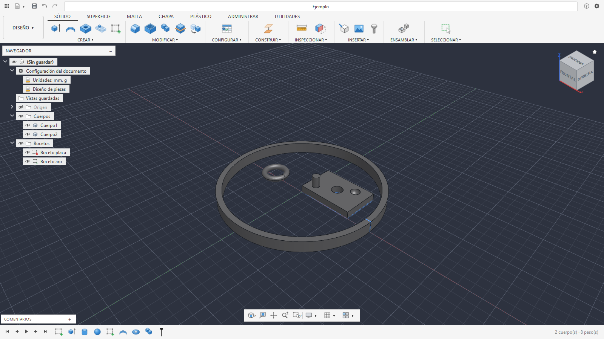
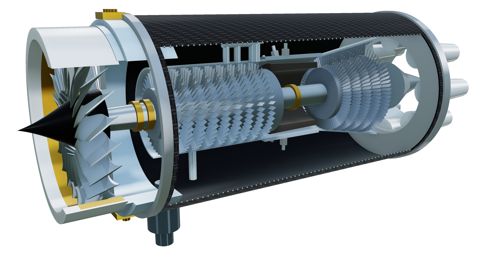
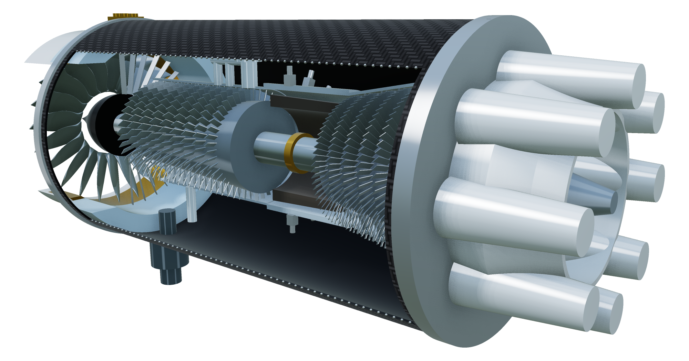
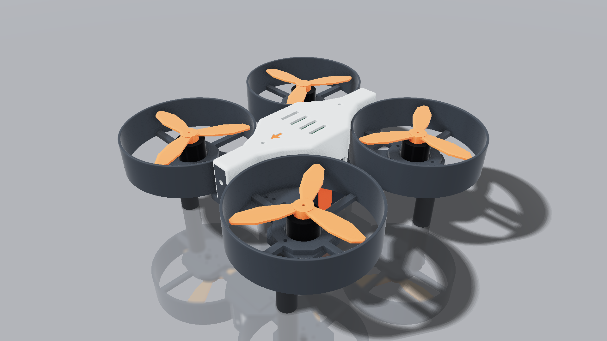

# OmniCAD

**Free and open parametric 3D CAD, written in Python.** You design with a history of steps (timeline) that recomputes
itself when you change a dimension, like professional CAD tools. And **AI agents** (Claude Code, OpenCode, Cursor,
Codex…) can drive it through MCP or the command line.

<div align="center">

## ☕ If OmniCAD helps you, support it

**OmniCAD is free and open.** It is built by one person, in their spare time.<br>
If it is useful to you, a donation helps keep it going.

<a href="https://ko-fi.com/jerryblackve"></a>

</div>

[Versión en español](README.md) · License [GPL-3.0](LICENSE) · Status: **alpha** (tested on Windows and on Ubuntu 24.04 under WSL2)



> The program and most of the documentation are in **Spanish** today. Full English support (UI, messages, tools and
> docs) is on the roadmap. Contributions in English are welcome.

## Features

- **Parametric design:** parameters with units and expressions (`ancho / 2 + 3 mm`, 35 unit families, functions and constants), model and user parameters, editable timeline, undo/redo.
- **Text on a curve:** sketch text with all installed fonts, spacing, a Character panel, and text that follows a curve and extrudes cleanly.
- **Constrained 2D sketches:** lines, arcs, circles, polygons, splines, dimensions and a constraint solver.
- **Solids:** extrude, revolve, sweep, loft, primitives, fillet, chamfer, shell, draft, holes, threads, ribs, patterns,
  mirror, booleans, split, scale, move and more.
- **Surfaces, sheet metal and meshes:** patch, trim, stitch, thicken; flanges, bends and flat pattern; repair, remesh,
  reduce and smooth meshes.
- **Basic assemblies:** components and subassemblies, joints, rigid groups, dragging with Capture and Revert, and fasteners.
- **Rebuild solid:** turns an STL, OBJ or 3MF made of extrusions and revolves into a part with history, without AI, and compares the part to the mesh in a deviation map.
- **Files:** open `.omnicad` project format (ZIP with a JSON recipe); exports STL, OBJ, 3MF, PLY, STEP, IGES and BREP;
  imports STEP; sketches from DXF and SVG.
- **Inspection:** volume, mass, area, bounding box, distances, angles, interference, draft, accessibility, minimum radius, zebra, curvature, section, carbon footprint (Sustainability Insights) and face groups.
- **In-app AI assistant:** a chat that designs and edits the part with the program's own tools, using an API key or your Claude Code, Codex or OpenCode subscription.
- **Interface:** 5 themes (modern dark, modern light, professional blue, minimalist and classic) plus user themes
  in a JSON file; toolbox on the S key (search and pin commands).
- **Geometry kernel:** [OpenCascade](https://dev.opencascade.org/) (B-rep).

## Examples of what has been built

A **1:1 scale turbofan engine** (3.86 m long, Ø1.43 m), designed by an AI agent in the running app (live mode) and
rendered with the OpenGL canvas of the RENDER space: 86 bodies and 174 parametric steps. Revolved profiles for the
nacelle, core and nozzle; a 22-blade twisted fan (loft and circular pattern); a 9-stage compressor and a 5-stage turbine
(hundreds of blades per pattern); metals and paints from the appearance library, and a carbon-fibre decal on the nacelle.




A **76 mm ducted-prop drone** (prototype A1) ready for 3D printing: 31 bodies, 73 parametric steps and a clearance
parameter (`holgura` = 0.12 mm) that tunes every fit. PETG monocoque chassis (132 × 132 mm), four prop guards and a
removable shell with vent slots, TPU legs and a non-slip battery pad, plus a cassette for the ELRS receiver. Every part
is named after its material, and the reference parts (`REF_NO_IMPRIMIR_…`: 1404 motors, three-blade props, Tattu 850 4S
battery, ESC, flight controller and receiver) sit in place to check that everything fits before printing. It also
includes a calibration plate and comb to find the clearance your printer needs.



## For AI agents

OmniCAD ships an **MCP server** and a **CLI** (`omnicad`) generated from a single tool catalog, so both always match.
An agent can create parts, measure them, look at a rendered image and export them; it can also work **live** on the
open window.

```
omnicad setup --cliente todos            # shows what it would configure in Claude Code, OpenCode and Cline CLI
omnicad setup --cliente todos --aplicar  # does it (backing up each file as .bak)
```

Tool names and parameters are in English (`create_box`, `fillet`, `radius`); descriptions and messages are in Spanish
for now. Docs: [docs/agentes/](docs/agentes/README.md).

## What's new in 0.2.0

- **Rebuild a solid from a mesh, without AI:** a mesh of extrusions, revolves, holes, fillets and chamfers becomes a part with history.
- **More faithful parameters:** own expression reader (no `eval`), 35 unit families, and renaming a parameter across the whole document.
- **Full CONSTRUCT and INSPECT:** planes, axes and points with all their modes; 15 inspection tools and a carbon footprint for the part.
- **Text on a curve:** each letter forms its own profiles, with per-font spacing and height, and extrudes without missing holes.
- **Smarter sketching:** drawing guides, Mirror, signed Offset, patterns and scale with live preview.
- **More solid, surface and assembly tools:** Edit face by contour, reviewed solid patterns, sweep with guides and subassemblies.
- **Faster:** a persistent worker edits with many steps without rebuilding everything, and the preview of heavy parts answers in 0.05 to 0.22 s after the first one.
- **Honest booleans:** Join, Cut and Intersect warn when the result does not add up instead of silently returning a bad volume.
- **Clearer drag handles** and tool panels built on a common system.
- **For agents:** 386 MCP/CLI tools in 17 groups (up from 349) and a local usage log, off by default and never sent over the network.

Full detail in the [CHANGELOG](CHANGELOG.md) (Spanish).

## Download (no coding needed)

Get the installer from the [latest release](https://github.com/JerryblackVe/OmniCAD/releases/latest):

| System | File | How |
|---|---|---|
| Windows 10/11 | `OmniCAD-…-windows-instalador.exe` | Run it and follow the steps. No admin needed. |
| Linux (Ubuntu 22.04 or newer) | `OmniCAD-…-x86_64.AppImage` | Make it executable (`chmod +x`) and run it. |

- To connect Claude Code or OpenCode: tick the option in the installer, or run `omnicad-cli setup --cliente todos --aplicar`.
- ⚠ Windows may show "Windows protected your PC" because the installer is unsigned: "More info" › "Run anyway".

The sections below are for running from source (to develop or try the latest).

## Install (Windows)

You need [Python 3.12](https://www.python.org/downloads/) and Git.

```
git clone https://github.com/JerryblackVe/OmniCAD.git
cd OmniCAD/clon
python -m venv .venv
.venv\Scripts\python.exe -m pip install -r requirements.txt
.venv\Scripts\python.exe -m pip install -e .
.venv\Scripts\python.exe OmniCAD.py --ejemplo
```

## Install (Linux)

Tested on Ubuntu 24.04 inside Windows with WSL2 (native Linux not tested yet). Besides Python 3.12 and Git, Qt needs a few system
libraries:

```
sudo apt install python3-venv libgl1 libegl1 libxkbcommon0 libxkbcommon-x11-0 libxcb-cursor0 libxcb-icccm4 \
  libxcb-keysyms1 libxcb-image0 libxcb-render-util0 libxcb-xinerama0 libxcb-shape0 libxcb-randr0 \
  libfontconfig1 libdbus-1-3 libglib2.0-0t64 fonts-dejavu-core
git clone https://github.com/JerryblackVe/OmniCAD.git
cd OmniCAD/clon
python3 -m venv .venv
.venv/bin/python -m pip install -r requirements.txt
.venv/bin/python -m pip install -e .
.venv/bin/python OmniCAD.py --ejemplo
```

- On WSL2, to draw with the graphics card (instead of the CPU): `export GALLIUM_DRIVER=d3d12` before launching.
- On Linux the app uses X11 (`xcb`; on Wayland desktops, through XWayland): with native Wayland the popup menus
  (radial menu) fail. To try Wayland anyway: `QT_QPA_PLATFORM=wayland`.
- The app keeps its own files (autosave, themes) in `~/.local/share/OmniCAD`.

## Contributing

The goal is to grow the project collaboratively. Start with [CONTRIBUTING.md](CONTRIBUTING.md) and
[AGENTS.md](AGENTS.md) (architecture, rules and recipes, for humans and AI coding agents alike).

## Roadmap

Pick any item and open an [Issue](https://github.com/JerryblackVe/OmniCAD/issues) or a Pull Request.

- **More platforms:** native Linux (WSL2 is tested), macOS, and a clean-machine test of the Windows installer.
- **3D printing:** split with connectors, molds, printer and material profiles, print-friendly holes, multicolor 3MF.
- **Gears of every kind:** a gallery to create bevel, worm, planetary and special gears and mechanisms.
- **Language:** Spanish and English everywhere; guided first launch.
- **Integration:** two-way Blender integration; connecting more AI agents.
- **AI assistant:** already in the app. Still missing: streaming replies, testing with Ollama and measuring what it spends per step.
- **Rebuild solid:** an STL, OBJ or 3MF made of extrusions, revolves, holes, fillets and chamfers already becomes a part with history, without AI (`reconstruct_from_mesh`). Still missing: the panel inside MESH, a parametric result (dimensioned sketches and named parameters), AI, free-form surfaces and parts that combine directions (oblique cuts, corners with spheres, knurling).
- **Phone scanning:** film a part and bring it into OmniCAD, ready to rebuild.
- **Plastic design:** snap fits, rests, two-sided bosses, part simplification and a fastener library.
- **Rendering:** materials, lighting, ideas from KeyShot and V-Ray.
- **New tools:** Rhino-style surfaces, Grasshopper-style visual node canvas, ideas from FreeCAD, Plasticity,
  SolidCraft and other open-source CAD.
- **FORM workspace** (T-spline subdivision surfaces): not started yet.
- **Fusion `.f3d` files** with their operation history.
- **Assemblies:** activating a component, contact sets, more joint position modes and motion limits, a fuller motion study.
- **Performance:** more hot paths in Rust and C++. Preview of heavy parts already runs in a persistent worker: the first one takes as long as before, the next ones 0.05 to 0.22 s on a 76-face plate; Shell on a 206-face plate still takes about 4 s.
- **Bug fixing:** see Known issues below.

### Known issues

There are 28 open bugs today (full list in [docs/seguimiento/bugs.md](docs/seguimiento/bugs.md), Spanish). Those that may affect you:

- **May close the app:** the Loft preview, a small fillet on a shelled part, Lip on a sphere, and opening a damaged STEP file.
- A fillet or chamfer larger than the wall of a shell leaves loose fins and the step still reports success: apply it before the shell.
- Other operations at extreme sizes can leave a broken body without warning: chamfer larger than the radius, pipe along cornered edges, large offset, and a hole tangent to two walls.
- Cutting with a sphere almost tangent to a wall can remove too little without warning.
- Tessellating or comparing with a mesh leaves a few very thin faces open on parts with over a thousand faces.
- A body that moves to another component can keep following the joint of its previous component.
- Re-solving a sketch with a tangent to a spline shifts it slightly each time.
- Projecting a curved body seen from the side gives its edges, not a closed silhouette.
- An old document with a piece of a split letter picked by hand no longer computes: pick the text again in that step.
- Exporting an animation to `.mp4` returns an internal error; use GIF or PNG.
- The Derive button is still greyed out in SOLID although it works from INSERT.
- A Minimum radius analysis saved earlier paints whole walls of a shell.
- `.f3d` import: some bodies of a test design are still unplaced.
- On Linux with native Wayland, pop-up menus close by themselves (the app forces X11, so it does not get in the way).
- Very rarely, recomputing parameters in a 148-step document brought the kernel down; it could not be reproduced.

### Next improvements

What already exists and can be better (about 140 rows in [docs/seguimiento/mejoras.md](docs/seguimiento/mejoras.md)):

- **Performance:** more Rust (meshes, sketch solver, sketch drawing, reduce and remesh).
- **Interface:** review every screen (empty states, errors, texts) and the typography.
- **Testing and installers:** GitHub CI and macOS, and `.deb` or Flatpak packages.
- **Fusion-like defaults:** for example, Extrude starts at 10 mm while Fusion starts at 0 mm.
- **Analysis:** region and country for the carbon footprint, and environment maps that reflect per face.

Functions that do not exist yet: about 225 rows in [docs/seguimiento/faltantes.md](docs/seguimiento/faltantes.md).

## Disclaimer

OmniCAD is an independent project. It takes the **workflow** of tools like Fusion 360, Blender and Rhino as a reference,
but **contains no code, text or assets** from them, and is not affiliated with or endorsed by Autodesk, the Blender
Foundation or Robert McNeel & Associates. Fusion 360 is a trademark of Autodesk, Inc.; Rhinoceros and Grasshopper are
trademarks of Robert McNeel & Associates.

## License

[GNU GPL v3.0 or later](LICENSE).

## Support the project

OmniCAD is free and built by one person. If it helps you, you can support it with a donation at
[ko-fi.com/jerryblackve](https://ko-fi.com/jerryblackve). Thank you!
