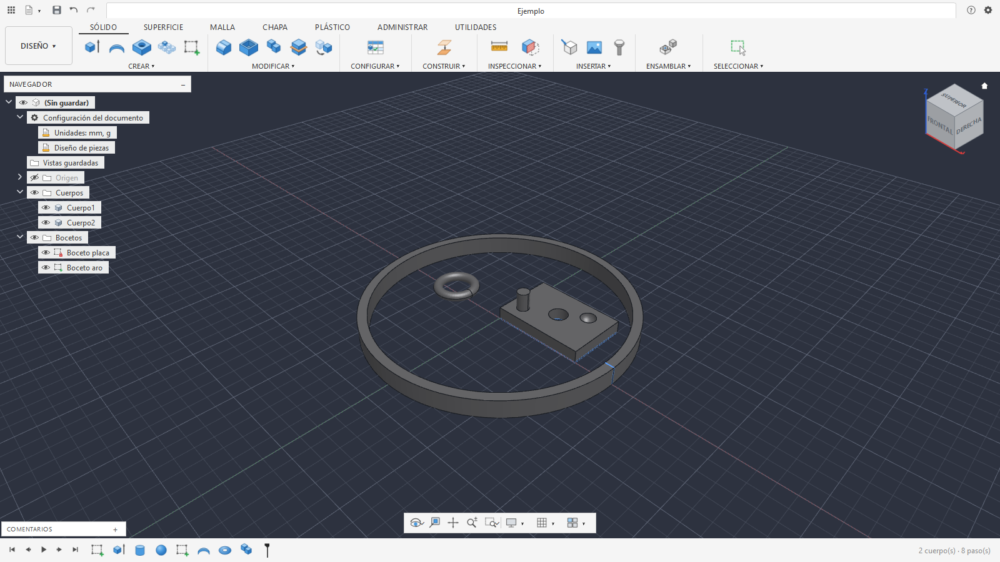
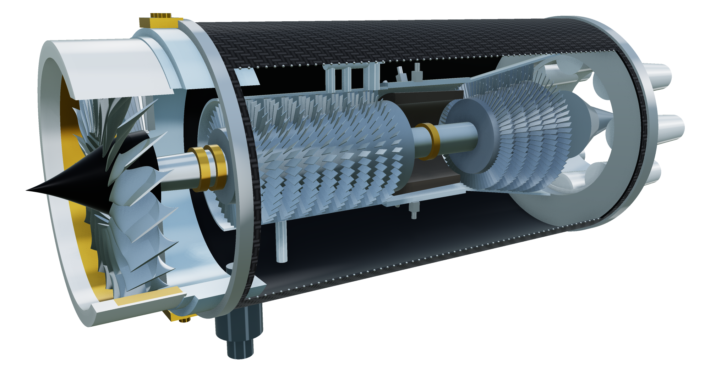
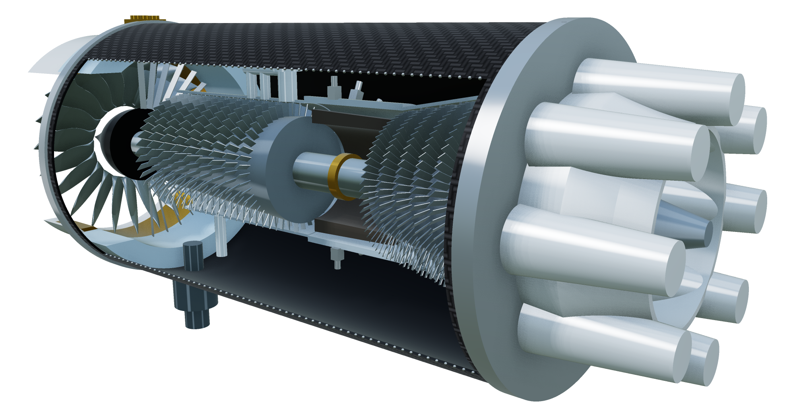
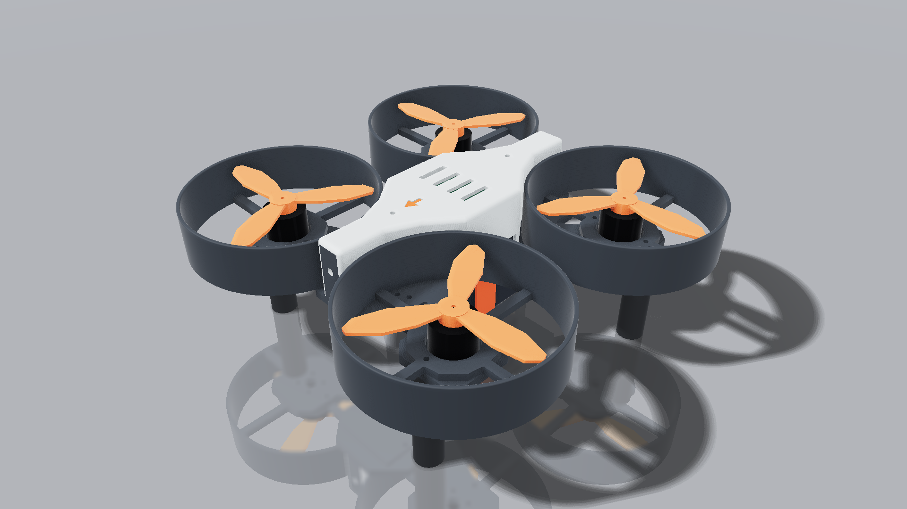

# OmniCAD

**CAD 3D paramétrico, libre y abierto, hecho en Python.** Diseñás con un historial de pasos (timeline) que se recalcula
solo cuando cambiás una medida, como en los CAD profesionales. Y además lo pueden manejar **agentes de IA** (Claude Code,
OpenCode, Cursor, Codex…) por MCP o por línea de comandos.

<div align="center">

## ☕ Si OmniCAD te sirve, apoyalo

**OmniCAD es libre y gratis.** Lo hace una sola persona, en su tiempo.<br>
Si te ayuda, una donación me ayuda a seguir.

<a href="https://ko-fi.com/jerryblackve"></a>

</div>

[English version](README.en.md) · Licencia [GPL-3.0](LICENSE) · Estado: **alfa** (probado en Windows y en Ubuntu 24.04 sobre WSL2)



## Qué tiene

- **Diseño paramétrico:** parámetros con unidades y expresiones (`ancho / 2 + 3 mm`, 35 familias de unidades, funciones y constantes), parámetros del modelo y de usuario, timeline editable, deshacer y rehacer.
- **Bocetos 2D con restricciones:** líneas, arcos, círculos, polígonos, splines, cotas y un solver de restricciones.
- **Texto y vectores:** texto de boceto con todas las fuentes instaladas (TrueType, OpenType, variables), espaciado, interlineado, alineación, caja, parámetros `{ancho}`, **texto sobre una curva** y un panel **Carácter** (kerning, inclinación, escala horizontal y vertical, línea base, mayúsculas / versalitas, subrayado y tachado que forman perfiles); el texto se edita con cursor, selección y portapapeles; insertar SVG por capas y colores, vectorizar una imagen, marco para mover, escalar, girar y espejar, unir / restar / intersecar perfiles, desfase y limpieza de geometría importada.
- **Sólidos:** extrusión, revolución, barrido, solevación, primitivas, empalme, chaflán, vaciado, desmoldeo, agujeros,
  roscas, nervios, patrones, simetría, booleanas, dividir, escalar, mover y más.
- **Superficies, chapa metálica y mallas:** parches, recortar, coser, engrosar; pestañas, pliegues y desplegado;
  reparar, remallar, reducir y suavizar mallas.
- **Ensamblaje básico:** componentes y subensamblajes, uniones, grupos rígidos, arrastrar con Capturar y Revertir, y fijaciones (tornillería).
- **Reconstruir sólido:** convierte un STL, OBJ o 3MF de extrusiones y revoluciones en una pieza con historial, sin IA, y compara la pieza con la malla en un mapa de desviación.
- **Archivos:** proyecto `.omnicad` abierto (ZIP con receta JSON); exporta STL, OBJ, 3MF, PLY, STEP, IGES y BREP;
  importa STEP; bocetos desde DXF, SVG e imágenes vectorizadas; guarda bocetos como DXF y SVG.
- **Inspección:** volumen, masa, área, caja envolvente, distancias, ángulos, interferencias, desmoldeo, accesibilidad, radio mínimo, cebra, curvatura, sección, huella de carbono (Sustainability Insights) y grupos de caras.
- **Asistente IA dentro de la app:** un chat que diseña y modifica la pieza con las herramientas del programa, con API o con tu suscripción de Claude Code, Codex u OpenCode.
- **Interfaz:** 5 temas (oscuro moderno, claro moderno, azul profesional, minimalista y clásico) y temas propios del
  usuario en un archivo JSON; caja de herramientas con la tecla S (buscar y fijar comandos).
- **Kernel geométrico:** [OpenCascade](https://dev.opencascade.org/) (B-rep), el mismo tipo de núcleo que usan los CAD comerciales.

## Ejemplos de lo que se hizo

Un **motor turbofán a escala 1:1** (3,86 m de largo, Ø1,43 m), diseñado por un agente de IA en la app abierta (modo en vivo)
y renderizado con el lienzo OpenGL de RENDERIZAR: 86 cuerpos y 174 pasos paramétricos. Perfiles girados para la góndola, el
núcleo y la tobera; fan de 22 álabes con torsión (solevación y patrón circular); compresor de 9 etapas y turbina de 5
(cientos de álabes por patrón); metales y pinturas de la biblioteca de aspectos, y una calcomanía de fibra de carbono
sobre la góndola.




Un **dron de hélices carenadas de 76 mm** (prototipo A1) listo para imprimir en 3D: 31 cuerpos, 73 pasos paramétricos y
un parámetro de holgura (`holgura` = 0,12 mm) que ajusta todos los encastres. Chasis monobloque en PETG (132 × 132 mm),
cuatro protectores de hélice y una carcasa desmontable con ranuras de ventilación, patas de TPU y apoyo antideslizante
para la batería, y un cassette para el receptor ELRS. Cada pieza está nombrada por su material y las de referencia
(`REF_NO_IMPRIMIR_…`: motores 1404, hélices tripala, batería Tattu 850 4S, ESC, controladora de vuelo y receptor) se
ubican en su lugar para comprobar que todo entra antes de imprimir. Trae también una placa y un peine de calibración
para medir qué holgura da tu impresora.



## Para agentes de IA

OmniCAD trae un **servidor MCP** y una **CLI** (`omnicad`) que salen de un único catálogo de herramientas: lo que hace
uno lo hace el otro. Un agente puede crear piezas, medirlas, mirar una imagen del resultado y exportarlas; también puede
trabajar **en vivo** sobre la ventana abierta.

```
omnicad setup --cliente todos            # muestra qué configuraría en Claude Code, OpenCode y Cline CLI
omnicad setup --cliente todos --aplicar  # lo hace (con copia .bak de cada archivo)
```

Todo está en [docs/agentes/](docs/agentes/README.md): cómo conectar cada cliente, la CLI, el modo en vivo y la lista
completa de herramientas.

## Novedades de la 0.2.0

- **Reconstruir sólido desde una malla, sin IA:** una malla de extrusiones, revoluciones, agujeros, empalmes y chaflanes pasa a ser una pieza con historial.
- **Parámetros más fieles:** lector propio de expresiones (sin `eval`), 35 familias de unidades y renombrar un parámetro en todo el documento.
- **CONSTRUIR e INSPECCIONAR completos:** planos, ejes y puntos con todos sus modos; 15 herramientas de inspección y huella de carbono de la pieza.
- **Texto sobre una curva:** cada letra forma sus perfiles, con espaciado y altura por fuente, y se extruye sin agujeros de menos.
- **Boceto más inteligente:** ayudas de dibujo con guías, Simetría, Desfase con signo, patrones y escala con vista previa viva.
- **Más sólido, superficie y ensamblaje:** Editar cara por el contorno, patrones de sólido revisados, barrido con guías y subensamblajes.
- **Más rápido:** un trabajador persistente edita con muchos pasos sin rehacer todo, y la vista previa de piezas pesadas responde en 0,05 a 0,22 s después de la primera.
- **Booleanas honestas:** Unir, Cortar e Intersecar avisan cuando el resultado no cierra en vez de dar un volumen malo en silencio.
- **Asas de arrastre más claras** y paneles de herramienta con un sistema común.
- **Para agentes:** 386 herramientas MCP/CLI en 17 grupos (eran 349) y un registro de uso local, apagado de fábrica y sin envío a la red.

Detalle completo en el [CHANGELOG](CHANGELOG.md).

## Descargar (sin programar)

Bajá el instalador de la [última versión](https://github.com/JerryblackVe/OmniCAD/releases/latest):

| Sistema | Archivo | Cómo |
|---|---|---|
| Windows 10/11 | `OmniCAD-…-windows-instalador.exe` | Abrilo y seguí los pasos. No pide administrador. |
| Linux (Ubuntu 22.04 o más nuevo) | `OmniCAD-…-x86_64.AppImage` | Dale permiso de ejecución (`chmod +x`) y abrilo. |

- Para conectar Claude Code u OpenCode: marcá la opción en el instalador, o corré `omnicad-cli setup --cliente todos --aplicar`.
- ⚠ Windows puede avisar «Windows protegió su PC» porque el instalador no está firmado: «Más información» › «Ejecutar de todas formas».

Las secciones de abajo son para correrlo desde el código (para programar o probar lo último).

## Instalación (Windows)

Necesitás [Python 3.12](https://www.python.org/downloads/) y Git.

```
git clone https://github.com/JerryblackVe/OmniCAD.git
cd OmniCAD/clon
python -m venv .venv
.venv\Scripts\python.exe -m pip install -r requirements.txt
.venv\Scripts\python.exe -m pip install -e .
.venv\Scripts\python.exe OmniCAD.py --ejemplo
```

- `OmniCAD.py` abre la app vacía; `OmniCAD.py pieza.omnicad` abre un proyecto.
- Después de `pip install -e .` quedan los comandos `omnicad` (CLI) y `omnicad-mcp` (servidor MCP).
## Instalación (Linux)

Probado en Ubuntu 24.04 dentro de Windows con WSL2 (falta una PC con Linux nativo). Además de Python 3.12 y Git, Qt necesita algunas
librerías del sistema:

```
sudo apt install python3-venv libgl1 libegl1 libxkbcommon0 libxkbcommon-x11-0 libxcb-cursor0 libxcb-icccm4 \
  libxcb-keysyms1 libxcb-image0 libxcb-render-util0 libxcb-xinerama0 libxcb-shape0 libxcb-randr0 \
  libfontconfig1 libdbus-1-3 libglib2.0-0t64 fonts-dejavu-core
git clone https://github.com/JerryblackVe/OmniCAD.git
cd OmniCAD/clon
python3 -m venv .venv
.venv/bin/python -m pip install -r requirements.txt
.venv/bin/python -m pip install -e .
.venv/bin/python OmniCAD.py --ejemplo
```

- En WSL2, para dibujar con la placa de video (y no con el procesador): `export GALLIUM_DRIVER=d3d12` antes de abrir.
- En Linux la app usa X11 (`xcb`; en escritorios Wayland, por XWayland): con Wayland nativo los menús emergentes
  (menú radial) fallan. Para probar Wayland igual: `QT_QPA_PLATFORM=wayland`.
- La app guarda lo suyo (autoguardado, temas) en `~/.local/share/OmniCAD`.

## Contribuir

El proyecto busca crecer de forma colaborativa. Empezá por [CONTRIBUTING.md](CONTRIBUTING.md).

- Para programar (personas o agentes de IA): [AGENTS.md](AGENTS.md) explica la arquitectura, las reglas y las recetas para
  agregar operaciones, comandos y herramientas.
- Arquitectura: [docs/arquitectura.md](docs/arquitectura.md). Bitácora y pendientes: [PROJECT_LOG.md](PROJECT_LOG.md).
- Errores e ideas: [Issues](https://github.com/JerryblackVe/OmniCAD/issues).

## Hoja de ruta

**¿Querés ayudar? Elegí cualquiera de estos pendientes y abrí un [Issue](https://github.com/JerryblackVe/OmniCAD/issues) o un Pull Request.** Antes leé [CONTRIBUTING.md](CONTRIBUTING.md) y [AGENTS.md](AGENTS.md).

- **Más plataformas:** Linux en una PC nativa (hoy probado en WSL2); macOS (hay que adaptar OpenGL 4.1, compilar el módulo Rust para Mac y firmar el instalador); validar el instalador de Windows en una PC limpia.
- **Impresión 3D:** cortar y dividir con conectores, moldes, canales internos, jarrones y macetas paramétricos, articulaciones, booleanas con holgura, corte por contorno, relieve desde imagen, texturas, color y 3MF multicolor, soportes, disposición en cama, vista en realidad aumentada y video de presentación.
- **Base para imprimir:** perfil de impresora y material, orientación recomendada, estimación de filamento y tiempo, cajas con tapa, bolsillos para imanes, insertos y rodamientos, y agujeros que imprimen sin soportes.
- **Engranajes de todo tipo:** una galería con imágenes y explicación corta para crear engranajes cilíndricos, cónicos, sin fin, planetarios, especiales, cremalleras y mecanismos (Ginebra, trinquete, reductores), desde la interfaz, la CLI o un agente de IA.
- **Idioma:** español e inglés en todo (interfaz, mensajes, herramientas y documentación); primer arranque guiado.
- **Integración:** Blender en los dos sentidos; conectar más agentes de IA.
- **Asistente IA:** ya viene en la app. Falta la respuesta en streaming, probarlo con Ollama y medir lo que gasta por paso.
- **Reconstruir sólido:** ya convierte un STL, OBJ o 3MF de extrusiones, revoluciones, agujeros, empalmes y chaflanes en una pieza con historial, sin IA (`reconstruct_from_mesh`). Falta el panel dentro de MALLA, el resultado paramétrico (bocetos acotados y parámetros con nombre), la IA, las superficies libres y las piezas que combinan direcciones (cortes oblicuos, esquinas con esferas, moleteados).
- **Escanear con el celular:** filmar una pieza y recibirla en OmniCAD lista para reconstruir.
- **Render:** materiales, colores e iluminación; ideas de KeyShot y V-Ray.
- **Vectores y texto:** curvas Bézier con manijas de tangente y simplificar con curvas ajustadas.
- **Ensamblajes:** activar un componente, conjuntos de contacto, más modos de posición y límites de las uniones, animación, simulaciones y movimiento de piezas.
- **Plástico:** encajes a presión, apoyos, salientes de dos lados, simplificar piezas y una biblioteca de fijadores.
- **Funciones nuevas:** estilo Rhino, programación visual estilo Grasshopper, ideas de FreeCAD y Plasticity.
- **Ideas de SolidCraft:** piezas de referencia para verificar el motor, pruebas de robustez automáticas, nombres estables de caras y aristas, bocetos que no saltan, configuraciones, conjuntos de contacto, vistas guardadas y ratón 3D.
- **Ideas de otros CAD libres:** que cada herramienta para agentes diga qué cambió de verdad, cambios de agente que se revisan antes de aplicarse, colores en el boceto para ver qué se puede mover, elegir caras por descripción y tutoriales que se reproducen paso a paso.
- **Espacio FORMA** (superficies de subdivisión T-splines): no existe todavía; es el pendiente más grande.
- **Menús y navegador:** los menús contextuales y varias opciones de la cinta que faltan frente a Fusion 360.
- **Abrir `.f3d`** de Fusion con su historial de operaciones y los diseños referenciados de un `.f3z`.
- **Rendimiento:** pasar los cuellos de botella a Rust y C++ (mallas, solver de bocetos) y acelerar las más pesadas. La vista previa de piezas pesadas ya usa un trabajador persistente: la primera tarda como antes y las siguientes 0,05 a 0,22 s en una placa de 76 caras; el Vaciado de una placa de 206 caras sigue en unos 4 s.
- **Interfaz:** pulido visual y sistema de temas propios que el usuario pueda crear y compartir.
- **Corrección de errores:** ver «Errores conocidos» más abajo.

Próximas funciones de boceto y modelado (lo que todavía falta frente a Fusion):

- Hélice 3D como curva de boceto (hoy hay solo espiral plana).
- Grupos en la línea de tiempo.

Estado de cada punto, verificado contra el código: [docs/seguimiento/](docs/seguimiento/README.md).

### Errores conocidos

Hoy hay 28 errores abiertos (lista completa en [docs/seguimiento/bugs.md](docs/seguimiento/bugs.md)). Los que pueden afectarte:

- **Pueden cerrar la app:** la vista previa de Solevación, un empalme chico sobre un vaciado, el Labio sobre una esfera y abrir un STEP dañado.
- Un empalme o chaflán más grande que la pared de un vaciado deja aletas sueltas y el paso sale bien: hacelo antes del vaciado.
- Otras operaciones con medidas al límite pueden dejar un cuerpo roto sin avisar: chaflán mayor que el radio, tubo por aristas con esquinas, desfase grande y agujero tangente a dos paredes.
- Cortar con una esfera casi tangente a una pared puede quitar de menos sin avisar.
- Teselar o comparar con una malla deja abiertas unas pocas caras muy finas en piezas con más de mil caras.
- Un cuerpo que pasa a otro componente puede seguir a la unión del componente anterior.
- Volver a resolver un boceto con una tangente a un spline lo corre un poco cada vez.
- Proyectar un cuerpo curvo visto de costado no da su silueta cerrada, solo sus aristas.
- Un documento viejo con un pedazo de letra partida elegido a mano ya no calcula: hay que volver a elegir el texto en ese paso.
- Exportar una animación a `.mp4` responde un error interno; usá GIF o PNG.
- El botón Derivar sigue grisado en SÓLIDO aunque funciona desde INSERTAR.
- Un análisis de Radio mínimo guardado antes pinta las paredes enteras de un vaciado.
- Importar `.f3d`: faltan por ubicar algunos cuerpos de un diseño de prueba.
- En Linux con Wayland nativo los menús emergentes se cierran solos (la app fuerza X11 y no molesta).
- Muy rara vez, recalcular parámetros en un documento de 148 pasos tumbó el kernel; no se pudo reproducir.

### Próximas mejoras

Lo que ya existe y se puede hacer mejor (unas 140 filas en [docs/seguimiento/mejoras.md](docs/seguimiento/mejoras.md)):

- **Rendimiento:** más Rust (mallas, solver de bocetos, dibujo del boceto, reducir y remallar).
- **Interfaz:** revisar cada pantalla (estados vacíos, errores, textos) y la tipografía.
- **Pruebas e instaladores:** CI en GitHub y macOS, y paquetes `.deb` o Flatpak.
- **Valores de fábrica como Fusion:** por ejemplo, Extruir arranca en 10 mm y Fusion en 0 mm.
- **Análisis:** región y país para la huella de carbono, y mapa de entorno con reflejo por cara.

Funciones que todavía no existen: unas 225 filas en [docs/seguimiento/faltantes.md](docs/seguimiento/faltantes.md).


## Aviso

OmniCAD es un proyecto independiente. Toma como referencia el **flujo de trabajo** de programas como Fusion 360, Blender
y Rhino, pero **no contiene código, textos ni recursos** de ellos. No está afiliado ni respaldado por Autodesk, la Blender
Foundation ni Robert McNeel & Associates. Fusion 360 es marca de Autodesk, Inc.; Rhinoceros y Grasshopper son marcas de
Robert McNeel & Associates.

## Licencia

[GNU GPL v3.0 o posterior](LICENSE). Podés usarlo, estudiarlo, modificarlo y compartirlo; si distribuís una versión
modificada, tiene que seguir siendo libre con la misma licencia.

## Apoyar el proyecto

OmniCAD es libre y gratis, y lo hace una sola persona. Si te sirve, podés apoyarlo con una donación en
[ko-fi.com/jerryblackve](https://ko-fi.com/jerryblackve). ¡Gracias!
